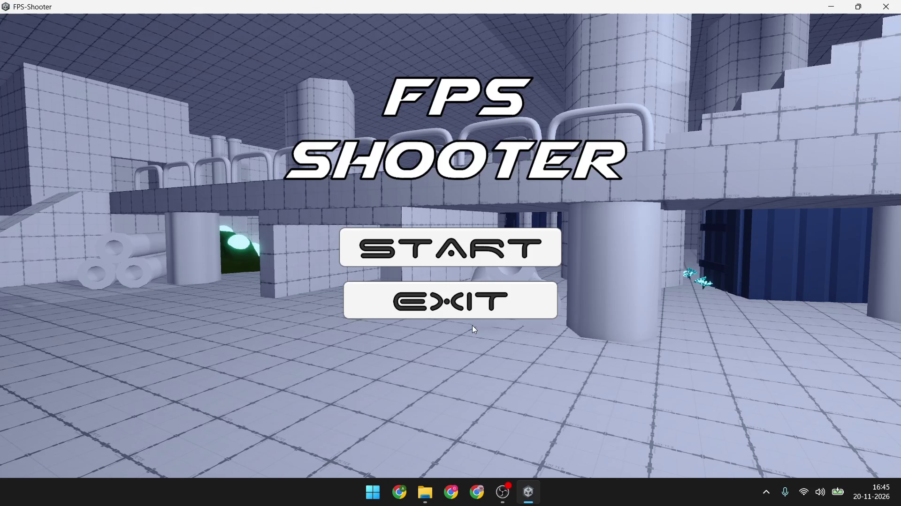
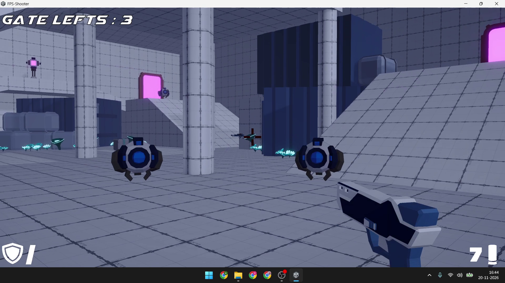
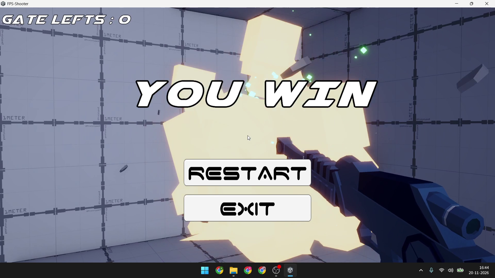
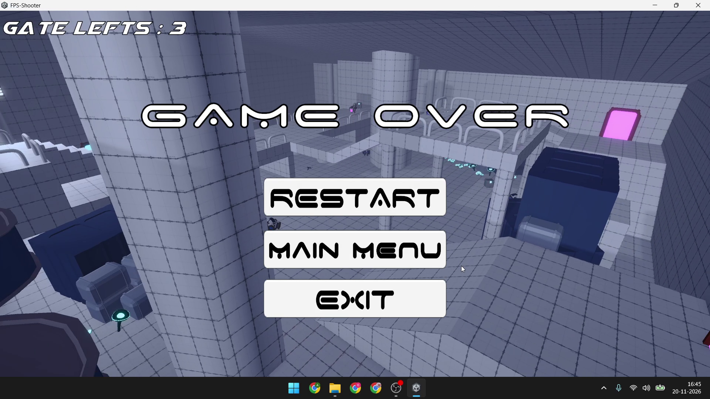

# FPS Shooter – Unity 6

A 3D First-Person Shooter project developed in Unity 6 using C#. This project was created as a practice and refresher project to improve my understanding of Unity development, C# scripting, enemy behaviour, NavMesh navigation, weapon mechanics, and scene management.

## 🎮 Game Overview

The objective is to destroy all three enemy spawn gates while surviving attacks from different enemy types.

The game features basic enemy navigation, projectile-based attacks, self-destructing flying enemies, weapon mechanics, and simple gameplay management.

## ✨ Features

- **First-Person Controller:** Player movement and camera controls.
- **NavMesh Navigation:** Basic enemy movement using NavMesh Agent to follow the player.
- **Flying Enemies:** Flying bots approach the player and self-destruct to deal damage.
- **Projectile Enemies:** Enemies shoot projectiles towards the player using Transform.LookAt().
- **Weapon System:** First-person shooting mechanics with different weapons using ScriptableObjects.
- **Weapon Pickups:** Pick up weapons during gameplay.
- **Ammo Pickups** Pickup Ammo Boxes to refill weapons.
- **Spawn Gates:** Three enemy spawn gates that generate enemies.
- **Win Condition:** Destroy all three spawn gates to complete the game.
- **Game Over System:** Displays a Game Over screen when the player is defeated.
- **Main Menu:** Simple Start and Exit menu with separate scenes.
- **Restart System:** Restart the gameplay after winning or losing.

## 🛠️ Technologies Used

| Technology | Purpose |
|---|---|
| Unity 6 | Game Engine |
| C# | Game Programming |
| NavMesh | Enemy Navigation |
| Visual Studio | Code Editor |
| Git & GitHub | Version Control |

## 🎯 Controls

| Action | Key |
|---|---|
| Move | W, A, S, D |
| Look Around | Mouse |
| Shoot | Left Mouse Button |
| Siffer Riffle Scope | Right Mouse Button |
| Jump | Space |

## 📸 Screenshots

### 1. Main Menu

<!-- Add your main menu screenshot below -->

### 2. Gameplay

<!-- Add your gameplay screenshot below -->

### 6. Game End Screens

**Victory Screen**

**Game Over Screen**

## 📌 Project Status

This is a practice and learning project focused on refreshing Unity fundamentals and implementing basic FPS gameplay systems.

The project is not fully optimized and may receive further improvements in the future.

## 👨‍💻 Developer

**Akash Devnath**

[GitHub Profile](https://github.com/akash-devnath)